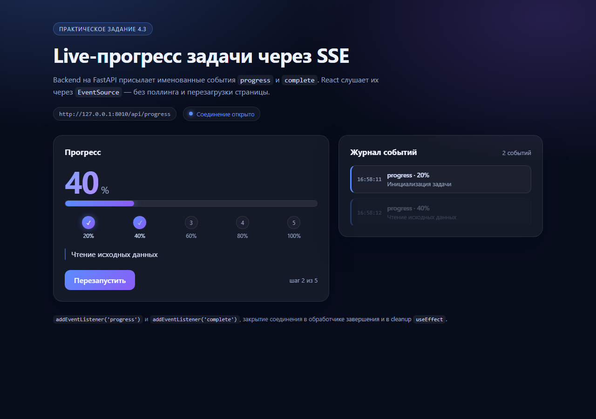
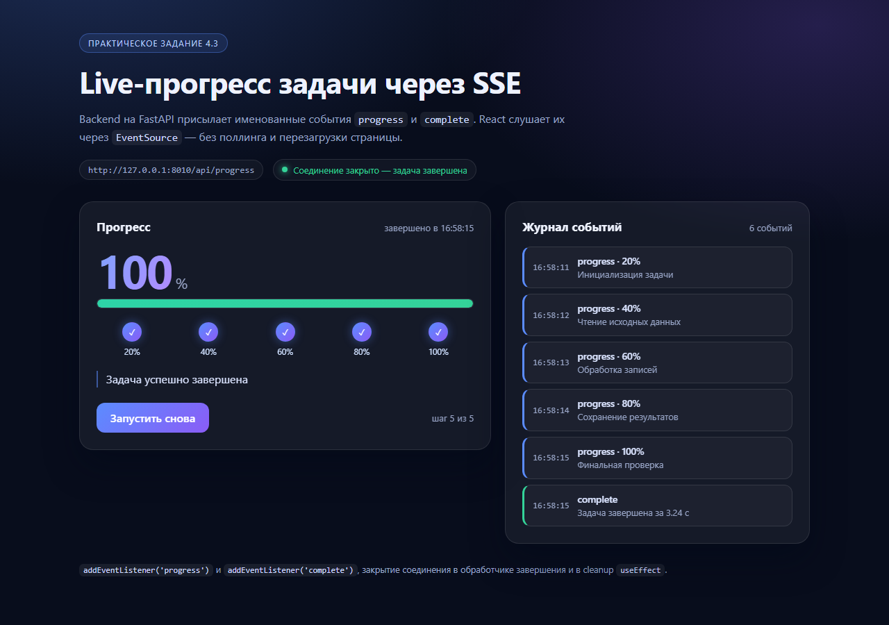
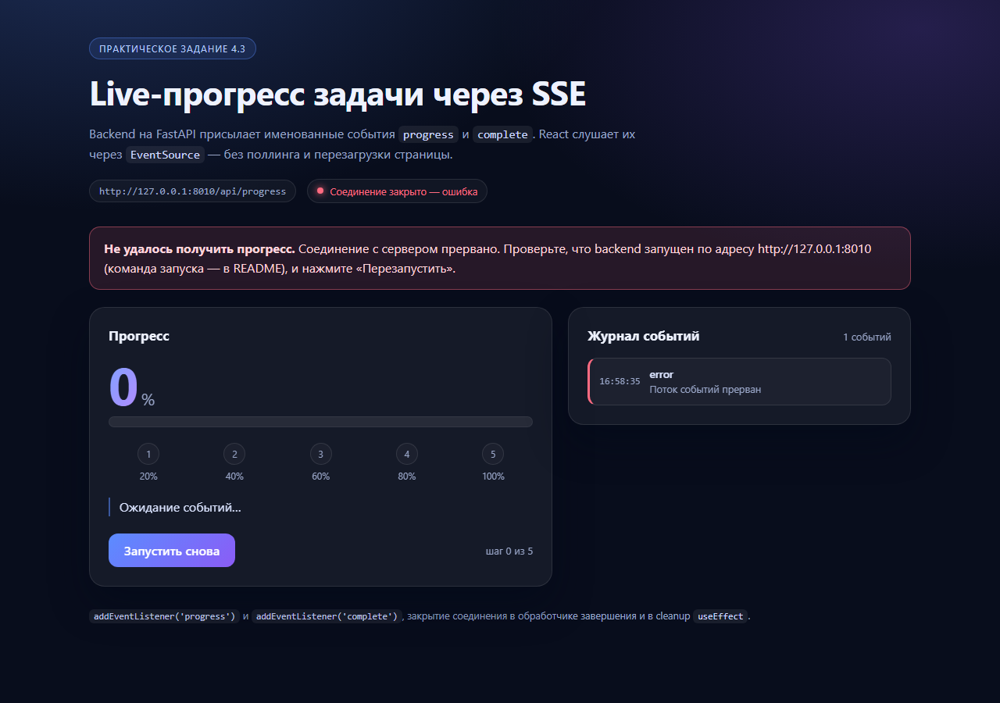

# Практическое задание 4.3 — Подключение SSE к React: EventSource API

Полный цикл live-обновления прогресса: FastAPI отправляет серию именованных
Server-Sent Events, React показывает прогресс в реальном времени через `EventSource` —
без перезагрузки страницы и без поллинга.

**Стек:** FastAPI, sse-starlette, SSE, React 18, Vite, EventSource API.



## Возможности

- SSE-эндпоинт `GET /api/progress` отправляет **5 событий `progress`** с нарастающими
  значениями (20, 40, 60, 80, 100 %) и **финальное событие `complete`**.
- События **именованные**: `event: progress` и `event: complete`, каждое со своим
  JSON-полем `data`; клиент разбирает их через `addEventListener`, а не `onmessage`.
- React-компонент создаёт `EventSource` в `useEffect` с корректным массивом
  зависимостей (`[runId]`) и закрывает соединение в cleanup-функции.
- Прогресс визуализирован: крупный процент, плавно заполняющийся прогресс-бар,
  отметки шагов и журнал полученных событий — всё обновляется по мере прихода событий.
- `eventSource.close()` вызывается и после события `complete`, и в `return () => ...`
  внутри `useEffect` — «висящих» соединений не остаётся.
- `onerror` показывает пользователю понятное сообщение об обрыве связи и предлагает
  перезапуск; бесконечное автопереподключение браузера при этом останавливается.
- Backend корректно реагирует на закрытие соединения клиентом (`request.is_disconnected()`)
  и прекращает отправку.

## Структура

```
pythonreactkt04/
├── backend/
│   ├── main.py            # FastAPI: /api/progress (SSE), /api/health, CORS
│   ├── requirements.txt
│   └── smoke_test.py      # проверка SSE через реальный HTTP (при запущенном uvicorn)
├── frontend/
│   ├── src/App.jsx        # EventSource, addEventListener, прогресс-бар, журнал
│   ├── src/api.js         # адрес API, разбор data, текст ошибки
│   ├── src/main.jsx
│   ├── src/styles.css
│   ├── .env.example       # VITE_API_URL
│   └── vite.config.js
└── docs/                  # скриншоты интерфейса
```

## Запуск

### 1. Backend (терминал №1)

```bash
cd backend
python -m venv .venv
# Windows: .venv\Scripts\activate
# Linux/macOS: source .venv/bin/activate
pip install -r requirements.txt
uvicorn main:app --reload --host 127.0.0.1 --port 8000
```

- API: <http://127.0.0.1:8000>
- Swagger: <http://127.0.0.1:8000/docs>
- SSE-поток: <http://127.0.0.1:8000/api/progress>

### 2. Frontend (терминал №2)

```bash
cd frontend
npm install
npm run dev
```

Откройте <http://localhost:5173>. Если backend запущен на другом адресе, скопируйте
`frontend/.env.example` в `frontend/.env` и укажите `VITE_API_URL`.

> CORS на backend разрешён для `http://localhost:5173`, `http://127.0.0.1:5173`
> и любого локального dev-порта Vite (`http://localhost:<port>`).

После старта страница сама открывает поток событий и показывает прогресс; кнопка
«Перезапустить / Запустить снова» пересоздаёт `EventSource` (старое соединение при этом
закрывается cleanup-функцией).

## Формат SSE-потока

`GET /api/progress` → `text/event-stream`:

```
id: 1
event: progress
data: {"progress":20,"step":1,"total":5,"message":"Инициализация задачи"}

id: 2
event: progress
data: {"progress":40,"step":2,"total":5,"message":"Чтение исходных данных"}

...

id: 6
event: complete
data: {"progress":100,"step":5,"total":5,"elapsed_seconds":3.2,"message":"Задача успешно завершена"}
```

- `id` — порядковый номер события;
- `event` — имя события (`progress` / `complete`), поэтому на клиенте используется
  `addEventListener('progress', ...)` и `addEventListener('complete', ...)`;
- `data` — JSON с процентом, номером шага, сообщением и (для `complete`) длительностью.

`GET /api/health` возвращает `{"status": "ok"}`. Пауза между шагами по умолчанию
0,8 с и настраивается переменной окружения `SSE_STEP_DELAY` (в секундах).

## Как выполнены требования

| Требование | Реализация |
| --- | --- |
| 1. SSE-эндпоинт с 5 `progress` и `complete` | `backend/main.py`: `PROGRESS_STEPS = (20, 40, 60, 80, 100)`, `EventSourceResponse` |
| 2. Именованные события | каждое сообщение содержит `"event": "progress"` / `"event": "complete"` |
| 3. `EventSource` в `useEffect` | `frontend/src/App.jsx`: `new EventSource(PROGRESS_URL)` в эффекте с зависимостью `[runId]` |
| 4. `addEventListener` для обоих событий | `source.addEventListener('progress', ...)`, `source.addEventListener('complete', ...)` |
| 5. Визуальный индикатор | крупный процент, `role="progressbar"` с `aria-valuenow`, отметки шагов, журнал событий |
| 6. Закрытие соединения | `source.close()` в обработчике `complete` и в `return () => { ... }` эффекта |
| 7. Обработка ошибок | `source.onerror` → понятное сообщение в `.alert`, соединение закрывается, доступен перезапуск |

## Проверка

При запущенном backend:

```bash
cd backend
python smoke_test.py
```

Скрипт читает реальный HTTP-поток и проверяет:

- статус `200` и `Content-Type: text/event-stream`;
- ровно 5 событий `progress` со значениями `20, 40, 60, 80, 100` по возрастанию;
- ровно одно событие `complete` с `progress = 100`;
- что события именованные (`event:`), а `data` — корректный JSON;
- что `/api/health` отвечает `status = ok`.

Если backend запущен не на 8000, порт задаётся переменными `SMOKE_HOST` / `SMOKE_PORT`.

Сборка фронтенда:

```bash
cd frontend
npm run build
```

## Скриншоты

| Прогресс в реальном времени | Задача завершена | Ошибка соединения |
| --- | --- | --- |
|  |  |  |

> На скриншотах backend запущен на порту 8010 (`.env.local`), чтобы не конфликтовать с
> другим локальным сервисом. При стандартном запуске из README адрес будет
> `http://127.0.0.1:8000`.

## Переменные окружения

| Переменная | Где | Назначение |
| --- | --- | --- |
| `VITE_API_URL` | frontend | Базовый адрес API (по умолчанию `http://127.0.0.1:8000`) |
| `SSE_STEP_DELAY` | backend | Пауза между событиями прогресса в секундах (по умолчанию `0.8`) |
| `SMOKE_HOST`, `SMOKE_PORT` | backend | Адрес проверяемого сервера в `smoke_test.py` |
